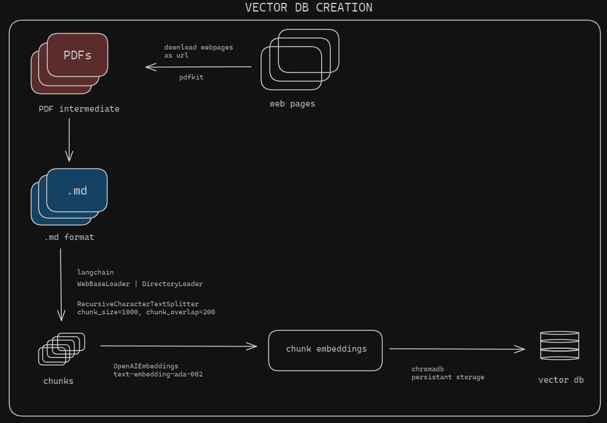
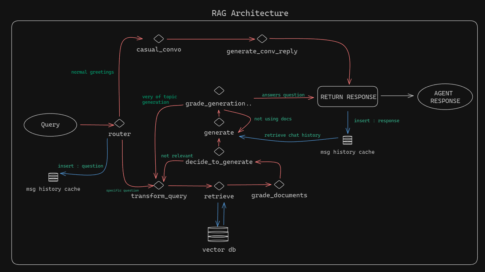

# 知识服务（knowledge-rag）

基于 LangGraph 的自适应 RAG 服务（FastAPI）：路由 → 问句改写 → 向量检索 → 文档评分 → 生成 → 幻觉/答案双校验，产出带**引用来源与推理步骤**的可信回答。知识域为腾讯产品技术文档与企业客服规则。

- **LLM**：腾讯混元 TokenHub（默认 `hy3`，中国站）
- **Embedding**：TokenHub（默认 `kinfra-text-embedding-0.6b`，1024 维）
- **向量库**：本地 Chroma（`db_md`，154 chunks）
- **默认端口**：`14052`

## 接口

| 接口 | 说明 |
|------|------|
| `GET /health` | 健康检查 |
| `GET /` | 服务说明 JSON |
| `POST /chat` | RAG 问答（`{question, session_id?}` → `{session_id, answer, sources, steps}`；空白问题 400） |
| `POST /chat/reset?session_id=` | 重置会话 |

## 快速开始

```powershell
copy .env.example .env    # 填 HUNYUAN_API_KEY（与模型网关可共用）与 EMBEDDING_API_KEY

# 依赖复现（推荐锁定版本；Python 3.13 标准版）
python -m venv .venv
.venv\Scripts\python.exe -m pip install -r requirements.lock.txt
# ⚠️ 重建 venv 后必须重做 chromadb 运行库补丁，见根目录 README 第 7 节

.\.venv\Scripts\python.exe server.py    # 或双击 run_server.bat
```

- 健康检查：http://127.0.0.1:14052/health
- 对话 UI：使用 `web/customer-console` 的「知识库 RAG」模式，地址 `http://127.0.0.1:14052`
- 终端问答：`.\.venv\Scripts\python.exe main.py`（输入 `exit` 退出）

## 向量库维护

- 知识源：`data/md`（30 篇文档，六类目：企业微信 / 腾讯会议 / 云服务器 / 对象存储 / 微信小程序 / 客服规则）
- 修改知识文件或更换 Embedding 模型后：`.env` 置 `REBUILD_VECTORSTORE=True` 启动建库，完成后**立即改回 `False`**
- 单次 RAG 问答约 50~95s（4~8 次串行模型调用），属正常设计

## 架构图




图节点名（`transform_query / retrieve / grade_documents / generate / generate_conv_reply`）是与前端 `STEP_LABELS` 的跨项目契约，改动两侧需同步（契约测试见 `tests/evidence/contract/`）。
